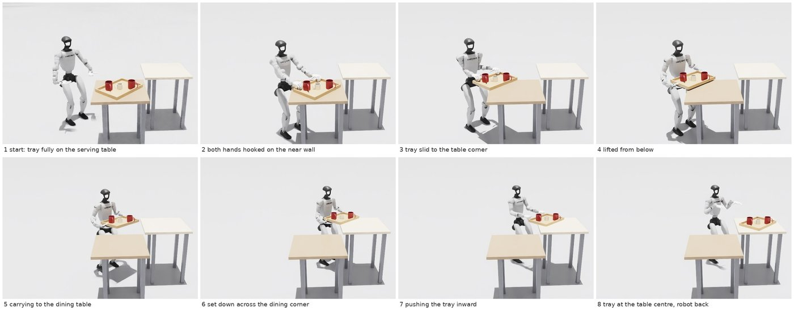

<p align="center">
  
</p>

<p align="center">
  <a href="https://pateldhruv1672.github.io/"></a>
  <a href="https://www.linkedin.com/in/dhruvpatel16/"></a>
  <a href="https://huggingface.co/dhruv1672"></a>
  <a href="mailto:dhruvkumarkamleshbhai.patel@sjsu.edu"></a>
  
</p>

<p align="center">
  <a href="https://git.io/typing-svg"></a>
</p>

I am a graduate researcher in the **Robotics & Digital Twin Lab at San José State University** (M.S. Applied Data Science). My work sits where robot learning, simulation and agentic AI meet: building the environments, datasets and policies that let robots do useful multi-step tasks, and measuring honestly how well they do them. Before graduate school I shipped production retrieval and ML systems at **Bain & Company** and distributed data services at **Samsung Research**.

```yaml
whoami:
  role:      Graduate Researcher, Robotics & Digital Twin Lab @ SJSU
  focus:     [robot learning, VLA fine-tuning, multi-robot agents, sim-to-real evaluation]
  sim:       [Isaac Sim 6, Isaac Lab 3, MuJoCo, Gazebo]
  robots:    [Unitree Go2, UFactory xArm 7, Unitree G1 (sim), SO-101 (sim)]
  ml:        [PyTorch, LeRobot, SmolVLA, diffusers + PEFT, vLLM, NVFP4]
  agents:    [LangGraph, MCP, Neo4j memory, RAG]
  compute:   [NVIDIA DGX Spark (GB10), RTX 5080 laptop]
  previously: [Bain & Company (SWE II), Samsung R&D Institute India (SWE)]
  principle: "report what was measured, including the negative results"
```

---

## Recent work (Sep to Nov 2026)

### Cross-Bot: a multi-robot service system &nbsp;·&nbsp; M.S. thesis, in progress

A bimanual xArm 7 coffee station, a Unitree G1 that carries trays between tables and a Go2 that explores and navigates. Each robot runs its own LangGraph agent; they coordinate through a shared Neo4j memory and durable handover records. Everything runs in Isaac Sim today, designed so the same stack moves to the real robots. The code stays private while the thesis is in progress; the datasets are public.

<p align="center">
  
  <br/><sub>Unitree G1 (29 DoF, BrainCo Revo2 hands) transferring a tray between two tables, one recorded episode (seed 2301).</sub>
</p>

<p align="center">
  
  <br/><sub>Bimanual xArm 7 coffee serving, bird's-eye camera from a recorded run: cup to the outlet, brew, handover to the tray arm.</sub>
</p>

| Output | Contents | Notes |
|---|---|---|
| [`crossbot-g1-tray-delivery-rgbd`](https://huggingface.co/datasets/dhruv1672/crossbot-g1-tray-delivery-rgbd) | 50 episodes, 64,741 frames at 10 Hz, head D435i RGB + lossless depth, 51-D state / 44-D action | Pilot batch, LeRobot v3.0, 27.1 GB; flagged for review before training use |
| [`crossbot-coffee-serving-100-skills`](https://huggingface.co/datasets/dhruv1672/crossbot-coffee-serving-100-skills) | 100 complete runs from 200 randomised attempts, cut into 400 skill episodes (92,670 frames) | Three cameras (bird's-eye + both wrists), 15 fps |

### Isaac Sim model of the Intel RealSense D435i &nbsp;·&nbsp; [repo](https://github.com/pateldhruv1672/isaac-sim-depth-camera-d435i)

A documentation-informed depth-camera surrogate for Isaac Sim 6 and ROS 2 Jazzy, developed natively on a DGX Spark (ARM64). It reproduces the behaviour that matters to a policy: invalid left band and stereo shadows, noise applied in disparity space (so error grows with distance squared), the 15 mm RGB-to-depth offset and an organised point cloud, all published on the same topics as the real driver.

<p align="center">
  
  <br/><sub>One timestamp-matched frame from every output stream, with the per-pixel error against ground truth.</sub>
</p>

### SmolVLA for SO-101 peg-in-hole insertion (Isaac Lab) &nbsp;·&nbsp; [model](https://huggingface.co/dhruv1672/smolvla-so101-peg-M6-recovery-vision-trained)

Fine-tuned `lerobot/smolvla_base` on scripted-expert demonstrations of an SO-101 arm inserting a 20 mm peg into a blind hole at 0.5 to 2.5 mm clearance, then studied what actually moves closed-loop success: chunk-relative actions, a trainable vision encoder, recovery demonstrations and serving-time filters.

<p align="center">
  
  <br/><sub>Overhead and wrist cameras from an expert demonstration in the training data.</sub>
</p>

| Policy (development scenes, 80 episodes each) | Success |
|---|---|
| M6, raw actions | 23 / 80 |
| M6 + constant-velocity Kalman filter on arm targets | **30 / 80** |
| Scripted expert, 0.5 to 1.0 mm clearance | 30 / 30 |

Not yet a reliable insertion controller; the model cards keep the negative results (such as fine-tuning on extra tight-clearance data making things worse) next to the positive ones.

### Simwright: an AI copilot for robot simulation &nbsp;·&nbsp; [repo](https://github.com/pateldhruv1672/simwright)

An MCP server and terminal copilot that builds and runs scenes in Isaac Sim, Isaac Lab, ROS 2, Gazebo and MuJoCo, then checks the result (physics stability, renders, reward curves, the live ROS graph) and repairs what broke. Works from Claude Code, Codex, Cursor, VS Code or ChatGPT.

```text
you   > Build a kitchen with a Unitree G1 standing at the table, utensils on it, and check the physics
agent > imports the G1 URDF, tunes drives, places SimReady assets on the tabletop, runs 3 s of physics,
        captures a frame, reports "83 bodies stable, nothing off the table"
```

### Spartan StudyBuddy: on-premise onboarding tutor &nbsp;·&nbsp; [repo](https://github.com/pateldhruv1672/spartan-studybuddy) · [model](https://huggingface.co/dhruv1672/spartan-studybuddy-qwen3.8-27b-nvfp4)

Turns a team's private repositories and documents into a role-specific onboarding curriculum with a Socratic tutor, running entirely on the team's own hardware. The tutor is Qwen3.8-27B with a LoRA on the last 16 layers, merged, quantised to NVFP4 (51.75 GiB → 18.73 GiB) and served with vLLM using the model's native multi-token-prediction head as a speculative drafter.

| DGX Spark (GB10), batch 1 | Decode tok/s (p50) | Draft acceptance |
|---|---|---|
| NVFP4, no speculation | 12.72 | n/a |
| NVFP4 + native MTP speculation | **18.61 (+46%)** | 74.1% |

### GRIDPILOT: autonomous on-call crew for a GPU cloud &nbsp;·&nbsp; [repo](https://github.com/pateldhruv1672/gridpilot)

Hackathon build: agents that detect and diagnose data-centre incidents, simulate remediation options, phone the on-call engineer for approval when policy requires a human, roll back their own failed fixes from git, and hold suspicious vendor invoices with cited reasons.

<p align="center">
  
  <br/><sub>A rack overheats and the incident opens with no human in the loop.</sub>
</p>

### Domain-style LoRA for Stable Diffusion 1.5 &nbsp;·&nbsp; DATA 266 coursework · [model](https://huggingface.co/dhruv1672/data266-pokemon-lora)

A config-driven sweep over LoRA rank (4 to 128) and alpha with cosine decay, EMA and min-SNR weighting; versions are tagged on Hugging Face and never overwritten. The same course project included a multimodal hybrid RAG system and a five-agent LangGraph image pipeline running on open-weight models.

<p align="center">
  
  <br/><sub>Same prompt and seed, base model (top) vs final LoRA (bottom). First four in-domain test prompts where neither image was blocked by the safety checker; not hand-picked.</sub>
</p>

| Held-out test (20 prompts × 2 seeds) | KID ↓ | Blinded human preference for style |
|---|---|---|
| SD 1.5 base | 0.0648 | n/a |
| + LoRA r64, α 64 | **0.0203** | **59 / 75 (78.7%)** over base, 3 raters |

---

## Earlier this year: real robots in the lab

<table>
<tr>
<td width="50%" valign="top">

<br/><b>Unitree Go2 semantic navigation</b> · <a href="https://github.com/pateldhruv1672/go2_ros">go2_ros</a><br/>
<sub>ROS 2 Jazzy workspace: SLAM, Nav2, semantic teach-and-resume navigation and an agentic skill layer on the wireless Go2.</sub>
</td>
<td width="50%" valign="top">

<br/><b>xArm 7 teleoperation and data capture</b> · <a href="https://github.com/pateldhruv1672/xarm-teleop">xarm-teleop</a> · <a href="https://github.com/pateldhruv1672/X-ARM-Teleop-meta-Quest">Quest teleop</a><br/>
<sub>Browser and VR teleoperation with live RGB, depth, segmentation and IMU over WebRTC, for demonstration datasets.</sub>
</td>
</tr>
</table>

Video walkthroughs of both are on the [portfolio](https://pateldhruv1672.github.io/).

## Data and software projects

| Project | What it does | Stack |
|---|---|---|
| [Avian Journeys](https://github.com/pateldhruv1672/Data-Visualization) | Analysis of 10,000+ migratory journeys: geospatial flight paths, weather effects, Power BI story | Python, Pandas, Power BI |
| [THE LAST DEGREE](https://github.com/pateldhruv1672/THE-LAST-DEGREE) | Degree ROI and skill demand from job-listing data | Adzuna API, Snowflake, dbt |
| [AutoQuote](https://github.com/pateldhruv1672/auto-quote) | Photo of vehicle damage → shop discovery → AI phone calls for quotes → booking | Vision API, VAPI, Leaflet |
| [Pinecone Search Engine](https://github.com/pateldhruv1672/Pinecone-Search-Engine) | End-to-end semantic search pipeline | SentenceTransformers, Pinecone, Airflow, Docker |
| [Stock forecasting](https://github.com/pateldhruv1672/Stock-Price-Forecasting-using-Snowflake-and-Airflow) | ETL, transformations and 14-day forecasts | Airflow, Snowflake, dbt |

<details>
<summary><b>Screenshots</b></summary>
<br/>
<p align="center">
  
  
  
  
</p>
</details>

## Toolbox

<p>
  
</p>
<p>
  
  
  
  
  
  
  
  
</p>

## Activity

<p align="center">
  
</p>

<p align="center"><sub>Open to research collaborations and robotics / applied-AI roles. The fastest way to reach me is <a href="https://www.linkedin.com/in/dhruvpatel16/">LinkedIn</a> or <a href="mailto:dhruvkumarkamleshbhai.patel@sjsu.edu">email</a>.</sub></p>
