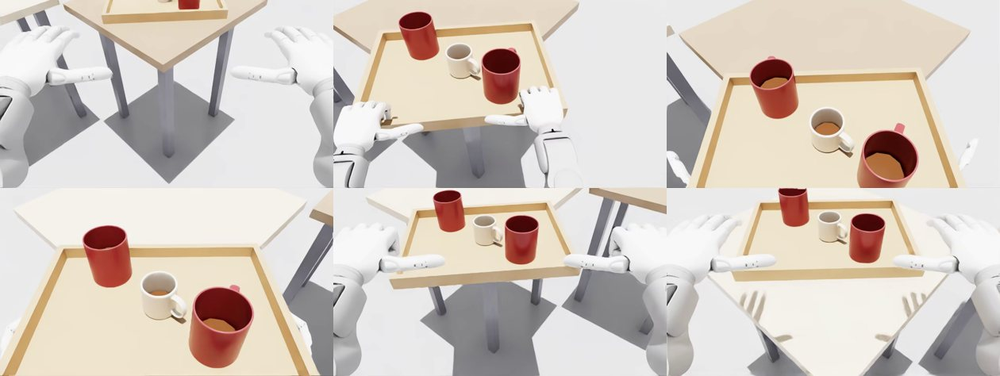
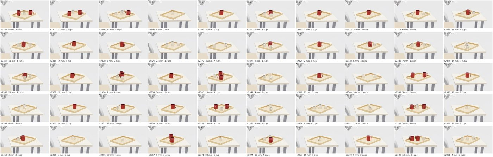
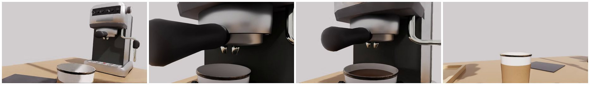
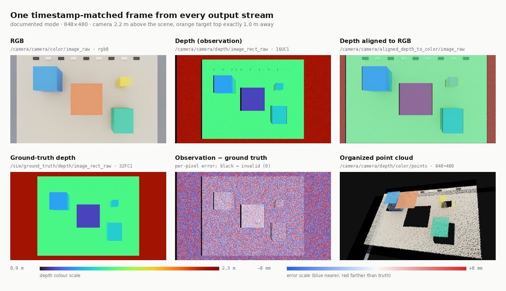
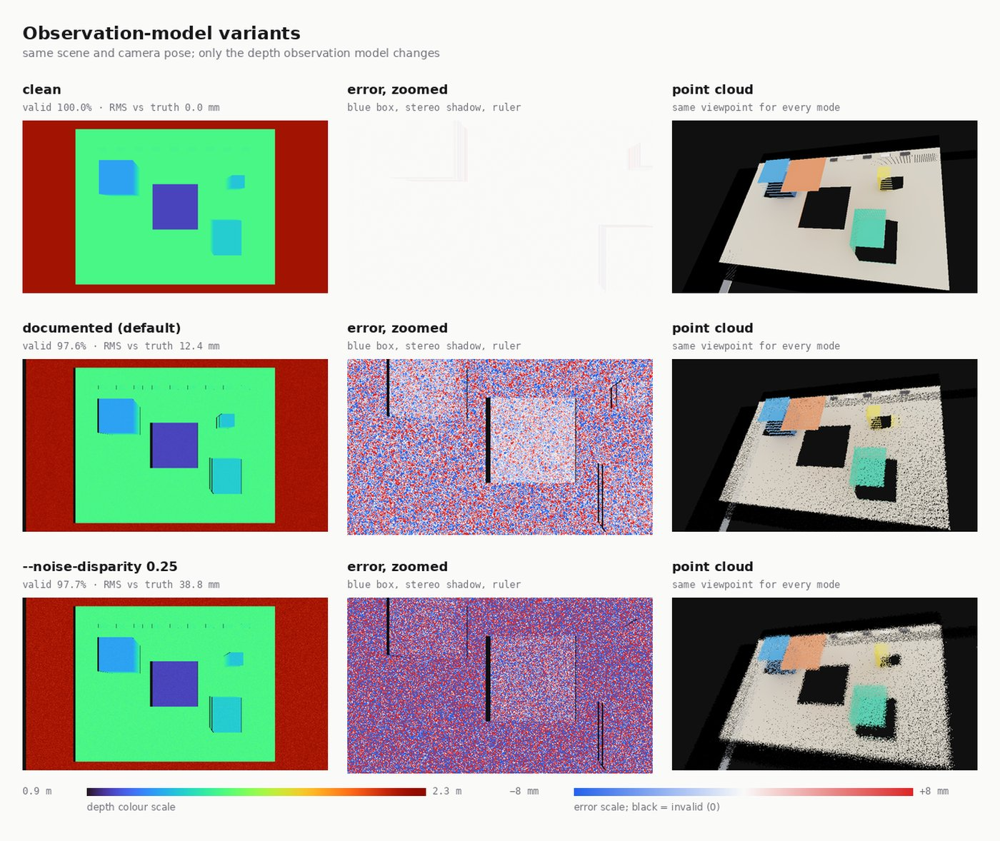
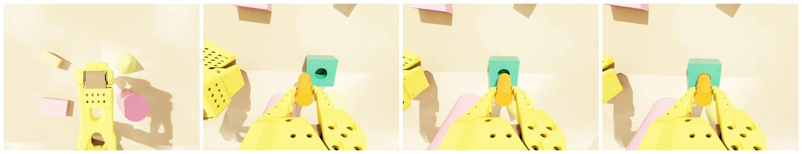
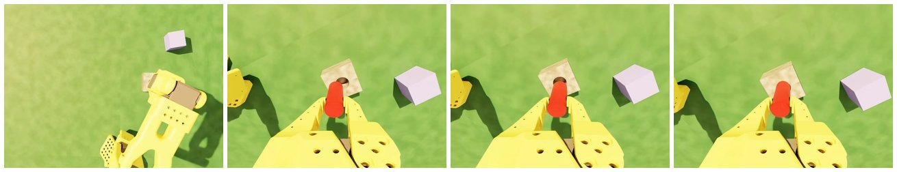
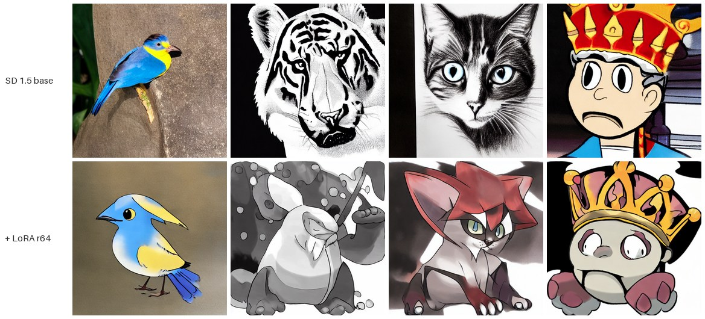
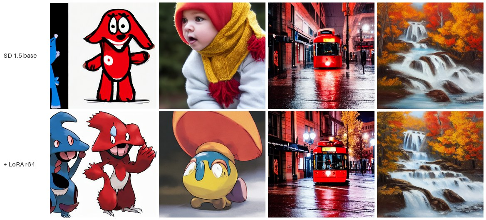

<p align="center">
  
</p>

<p align="center">
  <a href="https://pateldhruv1672.github.io/"></a>
  <a href="https://www.linkedin.com/in/dhruvpatel16/"></a>
  <a href="https://huggingface.co/dhruv1672"></a>
  <a href="mailto:dhruvkumarkamleshbhai.patel@sjsu.edu"></a>
  
</p>

<p align="center">
  <a href="https://git.io/typing-svg"></a>
</p>

I am a graduate researcher in the **Robotics & Digital Twin Lab at San José State University** (M.S. Applied Data Science). My work sits where robot learning, simulation and agentic AI meet: building the environments, datasets and policies that let robots do useful multi-step tasks, and measuring honestly how well they do them. Before graduate school I shipped production retrieval and ML systems at **Bain & Company** and distributed data services at **Samsung Research**.

```yaml
whoami:
  role:      Graduate Researcher, Robotics & Digital Twin Lab @ SJSU
  focus:     [robot learning, VLA fine-tuning, multi-robot agents, sim-to-real evaluation]
  sim:       [Isaac Sim 6, Isaac Lab 3, MuJoCo, Gazebo]
  robots:    [Unitree Go2, UFactory xArm 7, Unitree G1 (sim), SO-101 (sim)]
  ml:        [PyTorch, LeRobot, SmolVLA, diffusers + PEFT, vLLM, NVFP4]
  agents:    [LangGraph, MCP, Neo4j memory, RAG]
  compute:   [NVIDIA DGX Spark (GB10), RTX 5080 laptop]
  previously: [Bain & Company (SWE II), Samsung R&D Institute India (SWE)]
  principle: "report what was measured, including the negative results"
```

---

## Recent work (Sep to Nov 2026)

### Cross-Bot: a multi-robot service system &nbsp;·&nbsp; M.S. thesis, in progress

A bimanual xArm 7 coffee station, a Unitree G1 that carries trays between tables and a Go2 that explores and navigates. Each robot runs its own LangGraph agent; they coordinate through a shared Neo4j memory and durable handover records. Everything runs in Isaac Sim today, designed so the same stack moves to the real robots. The code stays private while the thesis is in progress; the datasets are public.

<p align="center">
  
  <br/><sub>Unitree G1 (29 DoF, BrainCo Revo2 hands) transferring a tray of cups between two tables, one recorded episode (seed 2301).</sub>
</p>

<p align="center">
  
  <br/><sub>What the policy sees: the G1 head camera (simulated RealSense D435i) during the same task.</sub>
</p>

<p align="center">
  
  <br/><sub>Final frame of all 50 recorded episodes: the tray ends in the centre of the dining table every time (1 to 4 cups, randomised).</sub>
</p>

<p align="center">
  
  <br/><sub>Bimanual xArm 7 coffee serving, bird's-eye camera: cup to the outlet, brew, handover to the tray arm.</sub>
</p>

<p align="center">
  
  <br/><sub>Left wrist camera through the same run: empty cup, under the outlet, brewed, set down for the handover.</sub>
</p>

| Output | Contents | Notes |
|---|---|---|
| [`crossbot-g1-tray-delivery-rgbd`](https://huggingface.co/datasets/dhruv1672/crossbot-g1-tray-delivery-rgbd) | 50 episodes, 64,741 frames at 10 Hz, head D435i RGB + lossless depth, 51-D state / 44-D action | Pilot batch, LeRobot v3.0, 27.1 GB; flagged for review before training use |
| [`crossbot-coffee-serving-100-skills`](https://huggingface.co/datasets/dhruv1672/crossbot-coffee-serving-100-skills) | 100 complete runs from 200 randomised attempts, cut into 400 skill episodes (92,670 frames) | Three cameras (bird's-eye + both wrists), 15 fps |

### Isaac Sim model of the Intel RealSense D435i &nbsp;·&nbsp; [repo](https://github.com/pateldhruv1672/isaac-sim-depth-camera-d435i)

A documentation-informed depth-camera surrogate for Isaac Sim 6 and ROS 2 Jazzy, developed natively on a DGX Spark (ARM64). It reproduces the behaviour that matters to a policy: invalid left band and stereo shadows, noise applied in disparity space (so error grows with distance squared), the 15 mm RGB-to-depth offset and an organised point cloud, all published on the same topics as the real driver.

<p align="center">
  
  <br/><sub>Running on the DGX Spark: RViz with the organised point cloud and depth/RGB previews (left), Isaac Sim through the simulated colour camera (right).</sub>
</p>

<p align="center">
  
  <br/><sub>One timestamp-matched frame from every output stream, with the per-pixel error against ground truth.</sub>
</p>

<p align="center">
  
  <br/><sub>Observation-model variants on the same scene: clean, documented default (97.6% valid, 12.4 mm RMS) and a noisier disparity setting.</sub>
</p>

### SmolVLA for SO-101 peg-in-hole insertion (Isaac Lab) &nbsp;·&nbsp; [model](https://huggingface.co/dhruv1672/smolvla-so101-peg-M6-recovery-vision-trained)

Fine-tuned `lerobot/smolvla_base` on scripted-expert demonstrations of an SO-101 arm inserting a 20 mm peg into a blind hole at 0.5 to 2.5 mm clearance, then studied what actually moves closed-loop success: chunk-relative actions, a trainable vision encoder, recovery demonstrations and serving-time filters.

<p align="center">
  
  <br/><sub>Overhead and wrist cameras from an expert demonstration: approach and insertion.</sub>
</p>

<p align="center">
  
  <br/><sub>A second randomised scene (different floor, block, peg colour and lighting) from the training data.</sub>
</p>

| Policy (development scenes, 80 episodes each) | Success |
|---|---|
| M6, raw actions | 23 / 80 |
| M6 + constant-velocity Kalman filter on arm targets | **30 / 80** |
| Scripted expert, 0.5 to 1.0 mm clearance | 30 / 30 |

Not yet a reliable insertion controller; the model cards keep the negative results (such as fine-tuning on extra tight-clearance data making things worse) next to the positive ones.

### Simwright: an AI copilot for robot simulation &nbsp;·&nbsp; [repo](https://github.com/pateldhruv1672/simwright)

An MCP server and terminal copilot that builds and runs scenes in Isaac Sim, Isaac Lab, ROS 2, Gazebo and MuJoCo, then checks the result (physics stability, renders, reward curves, the live ROS graph) and repairs what broke. Works from Claude Code, Codex, Cursor, VS Code or ChatGPT.

```text
you   > Build a kitchen with a Unitree G1 standing at the table, utensils on it, and check the physics
agent > imports the G1 URDF, tunes drives, places SimReady assets on the tabletop, runs 3 s of physics,
        captures a frame, reports "83 bodies stable, nothing off the table"
```

### Spartan StudyBuddy: on-premise onboarding tutor &nbsp;·&nbsp; [repo](https://github.com/pateldhruv1672/spartan-studybuddy) · [model](https://huggingface.co/dhruv1672/spartan-studybuddy-qwen3.8-27b-nvfp4)

Turns a team's private repositories and documents into a role-specific onboarding curriculum with a Socratic tutor, running entirely on the team's own hardware. The tutor is Qwen3.8-27B with a LoRA on the last 16 layers, merged, quantised to NVFP4 (51.75 GiB → 18.73 GiB) and served with vLLM using the model's native multi-token-prediction head as a speculative drafter.

| DGX Spark (GB10), batch 1 | Decode tok/s (p50) | Draft acceptance |
|---|---|---|
| NVFP4, no speculation | 12.72 | n/a |
| NVFP4 + native MTP speculation | **18.61 (+46%)** | 74.1% |

### GRIDPILOT: autonomous on-call crew for a GPU cloud &nbsp;·&nbsp; [repo](https://github.com/pateldhruv1672/gridpilot)

Hackathon build: agents that detect and diagnose data-centre incidents, simulate remediation options, phone the on-call engineer for approval when policy requires a human, roll back their own failed fixes from git, and hold suspicious vendor invoices with cited reasons.

<p align="center">
  
  <br/><sub>A rack overheats and the incident opens with no human in the loop.</sub>
</p>

<p align="center">
  
  <br/><sub>The on-call engineer proposes a different rack by phone; the plan is re-simulated and measured against the forecast.</sub>
</p>

<table>
<tr>
<td width="50%" valign="top"><br/><sub>3D control room</sub></td>
<td width="50%" valign="top"><br/><sub>Agent operations and traces</sub></td>
</tr>
</table>
<table>
<tr>
<td width="50%" valign="top"><br/><sub>Invoice held with cited sources (duplicate PO, segregation of duties)</sub></td>
<td width="50%" valign="top"><br/><sub>Approval centre</sub></td>
</tr>
</table>
<table>
<tr>
<td width="50%" valign="top"><br/><sub>Digital-twin reliability view</sub></td>
<td width="50%" valign="top"><br/><sub>What-if scenarios</sub></td>
</tr>
</table>
<table>
<tr>
<td width="50%" valign="top"><br/><sub>GPU load</sub></td>
<td width="50%" valign="top"><br/><sub>Sustainability</sub></td>
</tr>
</table>

### Domain-style LoRA for Stable Diffusion 1.5 &nbsp;·&nbsp; DATA 266 coursework · [model](https://huggingface.co/dhruv1672/data266-pokemon-lora)

A config-driven sweep over LoRA rank (4 to 128) and alpha with cosine decay, EMA and min-SNR weighting; versions are tagged on Hugging Face and never overwritten. The same course project included a multimodal hybrid RAG system and a five-agent LangGraph image pipeline running on open-weight models.

<p align="center">
  
  <br/><sub>Same prompt and seed, base model (top) vs final LoRA (bottom). First four in-domain test prompts where neither image was blocked by the safety checker; not hand-picked.</sub>
</p>

<p align="center">
  
  <br/><sub>Harder prompts: two compositional (left) and two out-of-domain (right). The adapter restyles creatures but leaves a tram and a landscape largely unchanged.</sub>
</p>

<p align="center">
  
  <br/><sub>Training loss and EMA validation loss for every run of the rank/alpha sweep.</sub>
</p>

| Held-out test (20 prompts × 2 seeds) | KID ↓ | Blinded human preference for style |
|---|---|---|
| SD 1.5 base | 0.0648 | n/a |
| + LoRA r64, α 64 | **0.0203** | **59 / 75 (78.7%)** over base, 3 raters |

---

## Real robots in the lab

<p align="center">
  
  <br/><sub>Robotics & Digital Twin Lab, SJSU: Unitree G1, Unitree Go2 and the bimanual xArm 7 station.</sub>
</p>

### Unitree Go2 semantic navigation &nbsp;·&nbsp; [go2_ros](https://github.com/pateldhruv1672/go2_ros)

ROS 2 Jazzy workspace for the wireless Go2: SLAM and localisation, Nav2, semantic teach-and-resume navigation and an agentic skill layer (voice and motion skills).

<table>
<tr>
<td width="50%" valign="top"><br/><sub>Autonomous navigation pass in the lab</sub></td>
<td width="50%" valign="top"><br/><sub>Runtime: ROS 2 terminals and the live occupancy map</sub></td>
</tr>
</table>
<table>
<tr>
<td width="50%" valign="top"><br/><sub>Repeat traversal of a taught route</sub></td>
<td width="50%" valign="top"><br/><sub>Motion skills</sub></td>
</tr>
</table>

### xArm 7 teleoperation and demonstration capture &nbsp;·&nbsp; [xarm-teleop](https://github.com/pateldhruv1672/xarm-teleop) · [Quest teleop](https://github.com/pateldhruv1672/X-ARM-Teleop-meta-Quest)

Browser and Meta Quest teleoperation of the xArm 7 with live RGB, depth, segmentation and IMU streamed over WebRTC, used to record demonstration datasets on the real arms and in Isaac Sim.

<table>
<tr>
<td width="50%" valign="top"><br/><sub>Teleop dashboard with live D435i RGB, depth and segmentation</sub></td>
<td width="50%" valign="top"><br/><sub>VR multiview perception: RGB, depth and segmentation from two viewpoints</sub></td>
</tr>
</table>
<table>
<tr>
<td width="50%" valign="top"><br/><sub>The bimanual xArm 7 station</sub></td>
<td width="50%" valign="top"><br/><sub>Teleoperating the simulated arm in Isaac Sim</sub></td>
</tr>
</table>

### Sparse 3D memory and digital-twin reconstruction

Reconstructing the lab from camera captures (COLMAP), regenerating it as a sparse voxel scene (fVDB) inside Omniverse, and using the result as spatial memory for the robots.

<table>
<tr>
<td width="50%" valign="top"><br/><sub>COLMAP point cloud of the lab</sub></td>
<td width="50%" valign="top"><br/><sub>fVDB scene regeneration in Omniverse</sub></td>
</tr>
</table>
<table>
<tr>
<td width="50%" valign="top"><br/><sub>Point-cloud reconstruction and inspection</sub></td>
<td width="50%" valign="top"><br/><sub>Lab map built on the robot</sub></td>
</tr>
</table>

Video walkthroughs of the lab work are on the [portfolio](https://pateldhruv1672.github.io/).

---

## Featured projects

<details open>
<summary><b>Data pipelines I maintain</b></summary>
<br/>

| Pipeline | Components | Status |
|-------|-------------------|--------|
| Semantic search pipelines | SentenceTransformers → Pinecone → Airflow | Active |
| Analytics and forecasting engine | yfinance → Snowflake → dbt → dashboards | Active |
| Job-market intelligence | Adzuna → Snowflake → analytics | Active |

</details>

### Avian Journeys: bird migration analytics &nbsp;·&nbsp; [repo](https://github.com/pateldhruv1672/Data-Visualization)

<a href="https://github.com/pateldhruv1672/Data-Visualization">
  <p align="center">
    
  </p>
  <p align="center">
    
  </p>
</a>

<table>
<tr>
<td width="50%" valign="top"><br/><sub>Where birds are found, by habitat and species</sub></td>
<td width="50%" valign="top"><br/><sub>Environmental factors and migration interruptions</sub></td>
</tr>
</table>
<table>
<tr>
<td width="50%" valign="top"><br/><sub>Seasonal dynamics and nesting success</sub></td>
<td width="50%" valign="top"><br/><sub>Key statistics</sub></td>
</tr>
</table>

<table>
<tr>
<td width="50%">

**Highlights**
- Analysed **10,000+ migratory journeys**
- **Geospatial flight-path** visualisation
- Weather impact on migration success
- Interactive **Power BI** storytelling dashboard
- Python EDA with Pandas, Seaborn and Matplotlib

</td>
<td width="50%">

**Stack:** `Python` `Power BI` `Pandas` `Seaborn`

| Metric | Value |
|--------|-------|
| Variables analysed | 42 features |
| Records processed | 10,000+ |
| Visualisation type | Geospatial + BI |

</td>
</tr>
</table>

### THE LAST DEGREE: college ROI intelligence &nbsp;·&nbsp; [repo](https://github.com/pateldhruv1672/THE-LAST-DEGREE)

<a href="https://github.com/pateldhruv1672/THE-LAST-DEGREE">
  <p align="center">
    
  </p>
  <p align="center">
    
  </p>
</a>

<table>
<tr>
<td width="50%" valign="top"><br/><sub>Graduate ROI intelligence overview</sub></td>
<td width="50%" valign="top"><br/><sub>Layoff risk monitor</sub></td>
</tr>
</table>
<table>
<tr>
<td width="50%" valign="top"><br/><sub>Architecture: Scorecard, WARN, BLS and Adzuna → Airflow → analytics mart → Superset and web app</sub></td>
<td width="50%" valign="top"><br/><sub>Airflow DAG running the dbt models</sub></td>
</tr>
</table>
<p align="center">
  
  <br/><sub>dbt lineage from raw sources to the analytics mart.</sub>
</p>

| Goal | Approach | Outcome |
|-----------|--------------|----------|
| Analyse 1M+ job listings | Adzuna API → Snowflake | Career intelligence |
| Calculate degree ROI | dbt transformations | Data-driven decisions |
| Forecast skill demand | ML analytics | Forward-looking insights |

### AutoQuote: AI vehicle repair finder &nbsp;·&nbsp; [repo](https://github.com/pateldhruv1672/auto-quote)

<a href="https://github.com/pateldhruv1672/auto-quote">
  <p align="center">
    
  </p>
</a>

<p align="center">
  
  <br/><sub>Upload a damage photo, see nearby repair shops on the map.</sub>
</p>

<table>
<tr>
<td>

**Features**
- AI damage image analysis (Freepik Vision)
- Shop discovery (Yutori Research API)
- **Voice AI phone calls** to shops for quotes (VAPI)
- One-click appointment booking
- Interactive Leaflet maps

</td>
<td>

```
 damage photo ─► scan ─► find shops ─► call ─► book
     📸            🔍         🗺️          📞       📅
```

</td>
</tr>
</table>

### Pinecone semantic search engine &nbsp;·&nbsp; [repo](https://github.com/pateldhruv1672/Pinecone-Search-Engine)

<table>
<tr>
<td width="50%">

<a href="https://github.com/pateldhruv1672/Pinecone-Search-Engine">

</a>

</td>
<td width="50%">

**Capabilities**
- End-to-end semantic search pipeline
- SentenceTransformers embeddings
- Pinecone vector database
- Apache Airflow orchestration

**Stack:** `Python` `Pinecone` `Airflow` `Docker`

</td>
</tr>
</table>

### Stock price forecasting and analytics &nbsp;·&nbsp; [repo](https://github.com/pateldhruv1672/Stock-Price-Forecasting-Analysis-dbt-airflow)

<table>
<tr>
<td width="50%">

**Capabilities**
- ETL with Apache Airflow
- Snowflake data warehousing
- dbt transformations
- Snowflake ML forecasting (14-day horizon)
- Moving averages and volatility analysis

**Stack:** `Airflow` `Snowflake` `dbt` `Python`

</td>
<td width="50%">

<a href="https://github.com/pateldhruv1672/Stock-Price-Forecasting-Analysis-dbt-airflow">
 
</a>

</td>
</tr>
</table>

<p align="center">
  
  <br/><sub>Ticker search and price history in the forecasting app.</sub>
</p>

---

## Toolbox

**AI / ML**

<p>
  
</p>
<p>
  
  
  
  
  
  
</p>

**Data**

<p>
  
</p>
<p>
  
  
  
  
  
</p>

**Frontend and tooling**

<p>
  
</p>

---

## Activity

<p align="center">
  
</p>

<p align="center">
  
</p>

<p align="center"><sub>Open to research collaborations and robotics / applied-AI roles. The fastest way to reach me is <a href="https://www.linkedin.com/in/dhruvpatel16/">LinkedIn</a> or <a href="mailto:dhruvkumarkamleshbhai.patel@sjsu.edu">email</a>.</sub></p>
